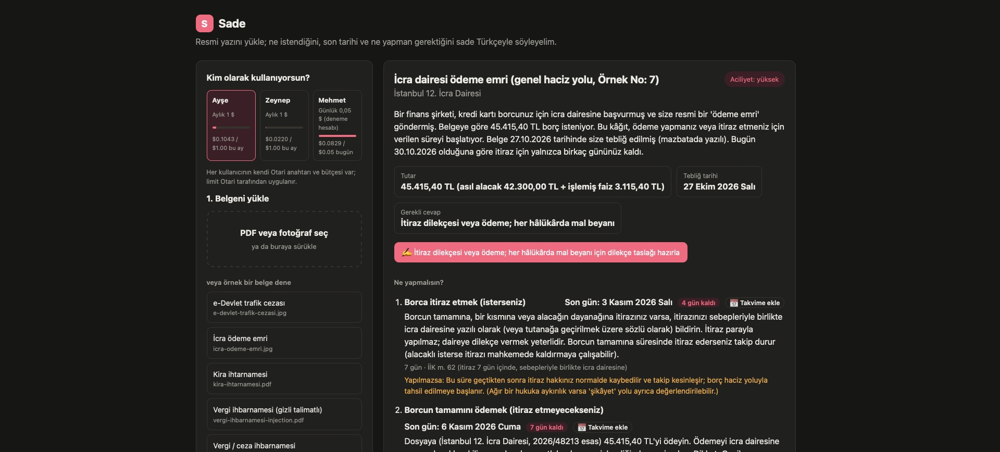
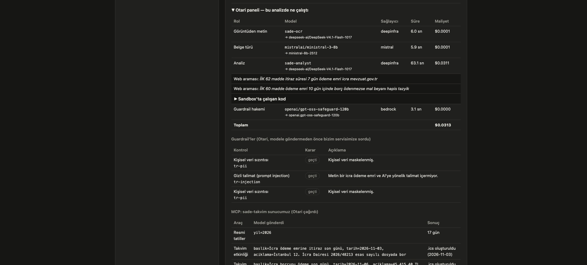
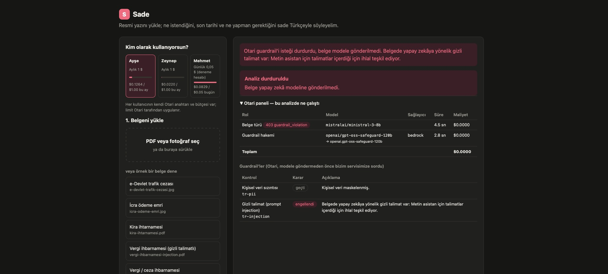
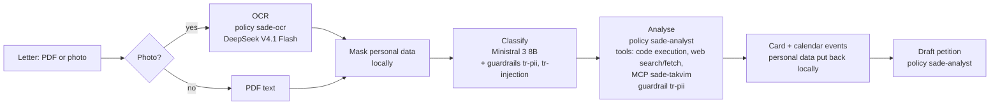

# Sade

**Plain-language help with Turkish official letters, built on open-weight models through [Otari](https://otari.ai).**

Built for MozFest *Developers Wilding: Online* (Mozilla.ai). Hackathon branch: `devs-wilding`.
**Demo video (3:35):** [sade-demo.mp4](https://github.com/sadopc/sade/releases/download/demo-video/sade-demo.mp4) · script: [docs/demo-script.md](docs/demo-script.md).



## The problem

Tax notices, enforcement orders, landlord notices and e-Devlet notifications
are written in dense legal Turkish. People miss the deadlines in them
(7 days to object to an enforcement order, 30 days to sue over a tax
assessment, 15 days to pay a traffic fine at a discount) and lose money or
rights because of it. These letters are also full of personal data.

## What Sade does

Upload a letter as a PDF or a phone photo. Sade tells you, in plain Turkish:

- what the letter is and who sent it, with a short summary;
- **what you need to do and by when**: each deadline is computed in code,
  moved past weekends and public holidays, and shown with the days left;
- the legal basis, checked against official sources on the web, with links;
- a calendar event (.ics) for each deadline;
- a draft reply or objection petition, when one is needed.

Personal data (national ID numbers, IBANs, phone numbers, e-mail addresses,
licence plates, names and addresses) is replaced with placeholders before any
text reaches a model, and put back only on the user's side.

Sade does not give legal advice; it tells users to check with a lawyer or the
issuing office before acting.

## How it uses Otari

Every AI call goes through the hosted Otari gateway, and every model is
open-weight.

| Otari feature (rubric) | How Sade uses it | Code |
|---|---|---|
| **Open-weight models, distinct roles** | DeepSeek V4.1 Flash 1017 reads photos (OCR), analyses the letter and drafts petitions; Mistral's Ministral 3 8B classifies the document type; OpenAI's gpt-oss-safeguard-120b judges prompt injection; Qwen3 235B and Qwen3 VL 235B are the fallbacks. | [`pipeline.py`](src/sade/pipeline.py), [`config.py`](src/sade/config.py) |
| **Model routing & fallbacks** | The app calls Otari routing policies, not models: `sade-analyst` (DeepSeek → Qwen3 235B), `sade-ocr` (DeepSeek → Qwen3 VL 235B) and `sade-analyst-backup` (DeepSeek on Fireworks → Nebius → Qwen3 235B). With "simulate a provider outage" on, calls go to `sade-analyst-demo`, which starts on a provider whose key is deliberately invalid, so you can watch Otari fall back (`Otari-Fallback: true`, `Otari-Attempt-Count: 2`). We found that hosted Otari does not fall back on streamed requests that declare gateway-run tools ([mozilla-ai/otari#2727](https://github.com/mozilla-ai/otari/issues/2727)); for those, the app resends a request that failed before any output to the next policy. | [`config.py`](src/sade/config.py), [`otari.py`](src/sade/otari.py) |
| **Code execution** | The analyst must compute every deadline in Python in Otari's sandbox (`code_interpreter`, `Otari-Code-Execution: otari`). The UI shows the code and its output. | [`pipeline.py`](src/sade/pipeline.py) |
| **Web search / web fetch** | `otari_web_search` and `otari_web_fetch` confirm the law article and period on mevzuat.gov.tr, gib.gov.tr and similar; the card lists the sources. | [`pipeline.py`](src/sade/pipeline.py), [`prompts.py`](src/sade/prompts.py) |
| **MCP integrations** | `sade-takvim`, our own MCP server (streamable HTTP, Python `mcp` SDK), passed inline in `mcp_servers`: Turkish public holidays, a working-day check, and calendar events (.ics) for deadlines. | [`mcp_takvim.py`](src/sade/mcp_takvim.py) |
| **Guardrails** | Otari's request-level `guardrails` call our `/validate` service in `block` mode: `tr-pii` stops any unmasked personal data, `tr-injection` stops letters with hidden instructions aimed at the AI (judged by gpt-oss-safeguard through Otari). A blocked request is `403 guardrail_violation` and no model sees the letter. | [`guard.py`](src/sade/guard.py) |
| **Budgets & spending limits** | A monthly spend ceiling on the whole Otari organization. | Otari dashboard |
| **Per-user budgets** | Each user calls Otari with their own API key, and each key holds its own budget ($1/month; $0.05/day for a trial user). When it is spent, Otari answers `403 budget_exceeded` before any model runs, and the UI says so. | [`personas.py`](src/sade/personas.py) |

Every call is tagged with `metadata` (role, user, document type) and an
`Otari-Conversation-Id`, so one analysis shows up as one session on the Otari
dashboard. The UI's **Otari panel** shows, for each call, the policy, the model
and provider that answered, fallbacks, cost, the sandbox code, the web
searches, the MCP calls and the guardrail verdicts.





### Flow of one analysis



Otari calls back into the app (our MCP server and guardrail service) through a
Cloudflare quick tunnel. Only paths under a secret prefix are served through
the tunnel; the rest of the app, including the analysis API, answers 404 there.

### Cost

One full analysis of a photographed letter (OCR, classification, analysis with
two sandbox runs and two web searches, guardrails, MCP) costs about
$0.02–0.05; a petition draft about $0.0005. The models themselves are cheap;
most of the cost is sandbox runs and web searches.

## Run it

Requirements: Python 3.12 with [uv](https://docs.astral.sh/uv/), an Otari
account, and `cloudflared` for the MCP server and guardrails
(`brew install cloudflared`).

```bash
cp .env.example .env              # Otari API key(s) and a random SADE_PUBLIC_SECRET
uv sync
uv run python scripts/make_samples.py   # fake sample letters into samples/
SADE_PORT=8765 uv run sade        # http://127.0.0.1:8765
scripts/tunnel.sh 8765            # public URL for Otari to reach MCP + guardrails
uv run pytest
```

Without the tunnel the app still works; it then skips MCP and the guardrails
(holidays go into the prompt instead).

In the Otari dashboard:

1. **Tools → Web search**: allow web access for the workspace.
2. **Routing → Policies**: create the fallback policies `sade-analyst` and
   `sade-ocr` (and optionally `sade-analyst-demo`, see above).
3. **Organization → Spend & budgets**: add budgets and an organization-wide
   spend ceiling.
4. **API keys**: one key per user, each with its budget; put them in `.env`
   as `OTARI_KEY_AYSE`, `OTARI_KEY_ZEYNEP`, `OTARI_KEY_MEHMET`.

## Sample letters

`samples/` holds five invented letters: a tax assessment, an enforcement order
(photo), a rent notice from a notary, an e-Devlet traffic fine (photo), and a
copy of the tax letter with a hidden prompt injection. Every person, number and
address in them is fake; the ID numbers are well-known test values.

Expected deadlines, which the tests also check:

| Letter | Served | Rule | Deadline |
|---|---|---|---|
| Tax assessment | 16.10.2026 | 30 days to sue or ask for settlement | Sun 15.11 → **Mon 16.11.2026** |
| Enforcement order | 27.10.2026 | 7 days to object, 10 days to pay | **03.11.2026**, **06.11.2026** |
| Rent notice | 22.10.2026 | 30 days to pay (TBK 315) | Sat 21.11 → **Mon 23.11.2026** |
| Traffic fine (e-Tebligat) | in e-box 25.10 → served 30.10.2026 | 15 days, 25% discount / objection | Sat 14.11 → **Mon 16.11.2026** |

## Privacy

- Text is masked before it leaves the app; the mapping back to real values
  never leaves the process. Cards, calendar files and petitions are filled in
  locally.
- A photo has to reach a vision model for OCR before it can be masked. That
  is the one place where unmasked data reaches a model, and it is an
  open-weight model served through Otari.
- The `tr-pii` guardrail makes masking enforceable: if unmasked data slips
  into a request, Otari blocks it.

## Feedback on Otari

What worked, what didn't, with reproduction steps: [FEEDBACK.md](FEEDBACK.md).

## License

[Apache-2.0](LICENSE), the same license as Otari.

## Disclaimer

Sade does not give legal advice. For important decisions, talk to a lawyer or
the issuing office.
